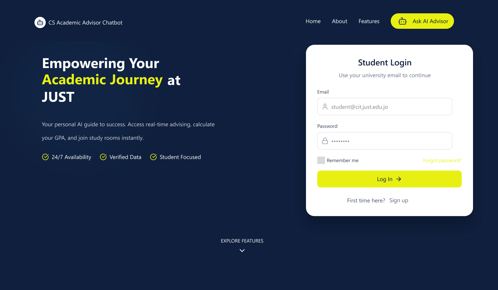

# Razan Mohaidat — Portfolio

Personal portfolio website built during my fourth year as a Computer Science student at Jordan University of Science & Technology.

🔗 **Live site:** https://razany-maker.github.io/my-portfolio/

## About
A responsive single-page portfolio that introduces me and showcases my graduation project, the **CS Academic Advisor Chatbot**, an AI-powered platform that makes academic planning easier for Computer Science students.

## Features
- About section with a short introduction
- Projects section presenting the graduation project's UI screens with design notes
- Sticky side navigation (About / Projects)
- Interactive cursor spotlight effect built with JavaScript
- Contact details (email and phone)
- Dark theme with a consistent color system (#131F3B, #FFFFFF, #EAF050)

## Built With
- HTML5
- CSS3 (Grid, custom properties)
- JavaScript (mouse-tracking spotlight effect)
- GitHub Pages (hosting)

## Run Locally
1. Clone the repo:
   `git clone https://github.com/razany-maker/my-portfolio.git`
2. Open `index.html` in your browser.

## Credits
Design inspired by [Brittany Chiang's portfolio](https://brittanychiang.com/).

## Contact
- Email: razan.yazid.m@gmail.com
- LinkedIn: [linkedin.com/in/razanyazid](https://www.linkedin.com/in/razanyazid)
